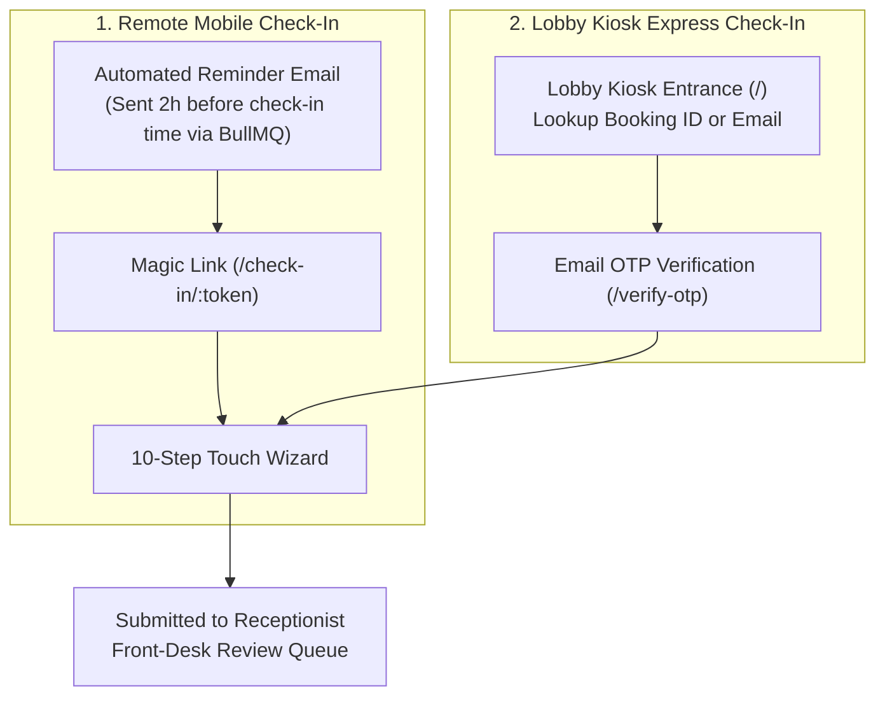

# Standalone Guest Self Check-In

Standalone, touchscreen-ready web application for guest digital self check-in in **HotelOS**. Supports both remote guest check-in from personal mobile devices and express lobby kiosk terminals.

- **Port**: `5178`
- **Package name**: `self-checkin`
- **Tech Stack**: React 19, TypeScript, Vite, Tailwind CSS v4 (`@tailwindcss/vite`)
- **Shared Packages**: Reuses `@hotelos/api`, `@hotelos/styles`, `@hotelos/ui`, `@hotelos/utils`
- **Backend API**: `apps/backend` (Express API on port `5001`)

---

## Dual Entry Flows



### 1. Remote Mobile Flow (`/check-in/:token`)

- Guests receive an automated email 2 hours before the hotel's `checkInTime` on arrival day, scheduled by the backend BullMQ worker.
- Clicking the magic link opens the 10-step wizard directly with secure token verification.

### 2. Express Lobby Kiosk Flow (`/` & `/verify-otp`)

- Tablet kiosk terminals display the lookup screen where guests enter their **Booking ID** or **Email address**.
- The backend dispatches a 6-digit one-time password (OTP) to the guest's verified email.
- The guest types the OTP into the touch-friendly numeric pad, authenticates their session, and immediately continues into the check-in wizard.

---

## 10-Step Self Check-In Wizard

1. **Welcome**: Hotel branding, stay dates, and express check-in overview.
2. **Booking Details**: Room type, guest count, rate summary, and policies.
3. **Guest Verification**: Personal contact verification and profile details.
4. **ID Card Upload**: Front and back government photo ID document capture.
5. **Live Selfie Capture**: In-browser camera capture for guest identity verification.
6. **Digital Registration Card**: Address, nationality, and legal compliance info.
7. **Signature Pad**: Touchscreen digital signature capture and terms agreement.
8. **Stay Preferences**: Estimated arrival time, dietary preferences, special requests.
9. **Final Review**: Comprehensive verification checklist before submission.
10. **Success Screen**: Confirmation receipt, digital key card instructions, and reception concierge guidance.

---

## Environment Variables

Copy `.env.example` to `.env`:

```bash
cp .env.example .env
```

| Variable       | Description                 | Default                 |
| :------------- | :-------------------------- | :---------------------- |
| `VITE_API_URL` | Base URL of HotelOS backend | `http://localhost:5001` |

---

## Development

```bash
# Run locally on port 5178 with LAN host exposure
pnpm dev

# Type check and build for production
pnpm build
```
